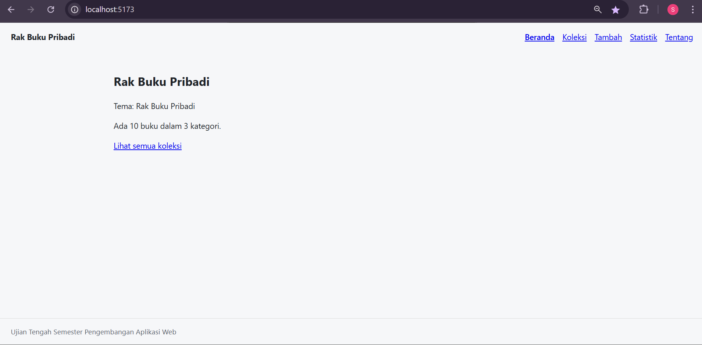
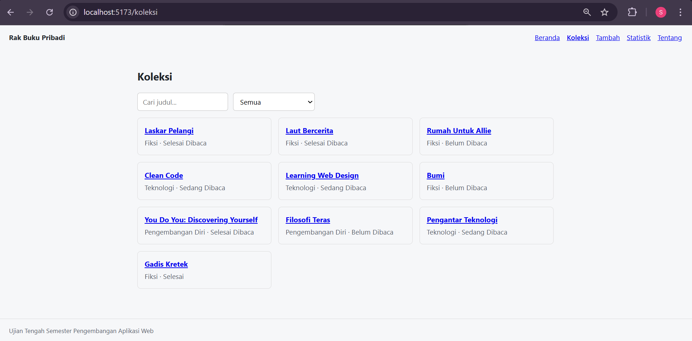
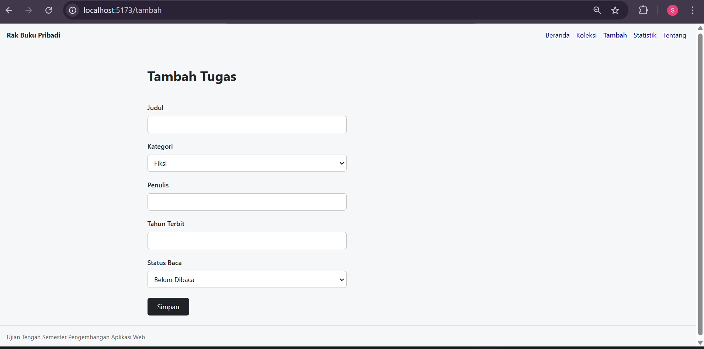
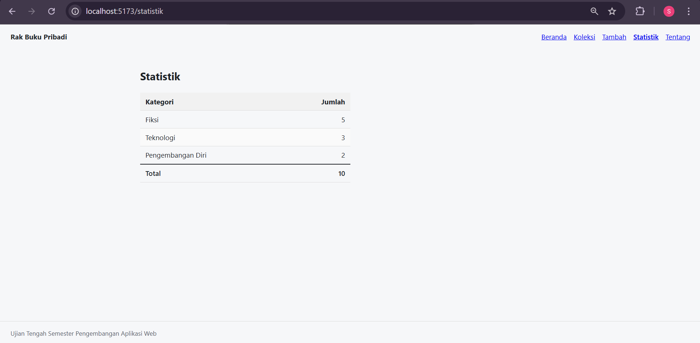
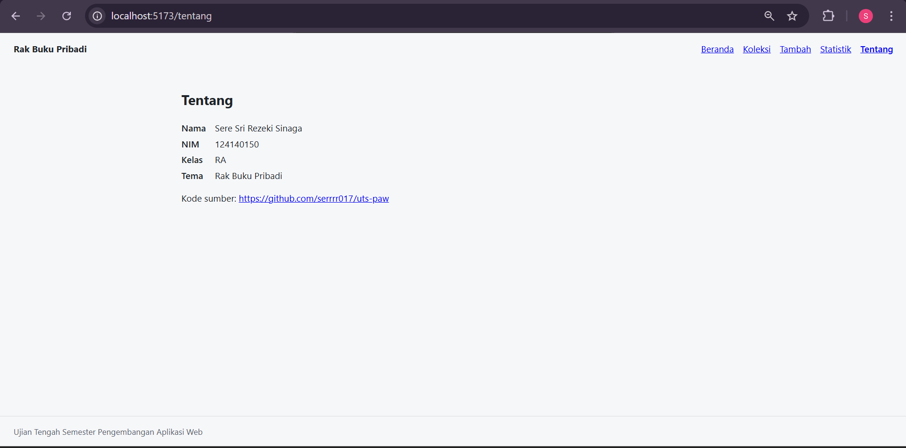

# Ujian Tengah Semester IF25-22014 Pengembangan Aplikasi Web

Repo induk Ujian Tengah Semester Pengembangan Aplikasi Web, Informatika ITERA, semester ganjil 2026/2027.

---

# Rak Buku Pribadi

Aplikasi web untuk mengelola koleksi buku pribadi, dibuat dengan React.

## Identitas

| | |
|---|---|
| **Nama** | Sere Sri Rezeki Sinaga |
| **NIM** | 124140150 |
| **Kelas** | RA |
| **Tema** | Rak Buku Pribadi |
| **Deployment** | [https://serrrr017.github.io/uts-paw/](https://serrrr017.github.io/uts-paw/) |

## Tampilan Aplikasi

### Beranda


### Koleksi


### Tambah


### Statistik


### Tentang


## Fitur

- Daftar koleksi buku, dimuat dari berkas JSON.
- Detail buku lengkap dengan judul, kategori, penulis, tahun terbit, dan status baca.
- Tambah buku lewat formulir dengan validasi judul.
- Hapus buku dengan konfirmasi.
- Statistik jumlah buku per kategori beserta total.
- Halaman Tentang berisi identitas mahasiswa dan tautan repo.
- Halaman 404 untuk alamat yang tidak terdaftar.
- Data tersimpan di localStorage, jadi tidak hilang saat halaman di-refresh.

## Menjalankan Secara Lokal

```bash
cd app
npm install
npm run dev
```

Lalu buka `http://localhost:5173/` di browser.

## Konsep React yang Dipakai

- **Komponen**: tampilan dipecah jadi bagian-bagian kecil yang bisa dipakai ulang, seperti lencana status dan pesan kosong.
- **Props**: cara mengirim data dari satu komponen ke komponen lain, misalnya mengirim status buku ke lencana.
- **useState**: tempat menyimpan data yang bisa berubah, seperti isi formulir dan pesan error.
- **Form terkontrol**: isi kotak input disimpan di React, jadi data yang diketik selalu bisa dibaca dan diperiksa.
- **Context dan custom hook**: data buku disimpan di satu tempat bersama dan bisa dipakai semua halaman lewat `useKoleksi`.
- **React Router**: untuk berpindah halaman tanpa memuat ulang browser. `useParams` mengambil id buku dari alamat, dan `useNavigate` memindahkan pengguna setelah simpan atau hapus.
- **Menampilkan daftar dengan map**: satu daftar buku diubah menjadi banyak baris tampilan sekaligus, dan setiap baris punya `key` yang unik.
- **Tampilan bersyarat**: bagian tertentu hanya muncul kalau kondisinya terpenuhi, seperti pesan error saat judul kosong atau pesan "tidak ditemukan".
- **reduce**: menghitung jumlah buku per kategori di halaman Statistik.
- **localStorage**: data buku disimpan di browser, jadi tidak hilang saat halaman di-refresh.
- **Pengujian**: test otomatis dengan Vitest dan Testing Library untuk memastikan komponen berjalan benar.